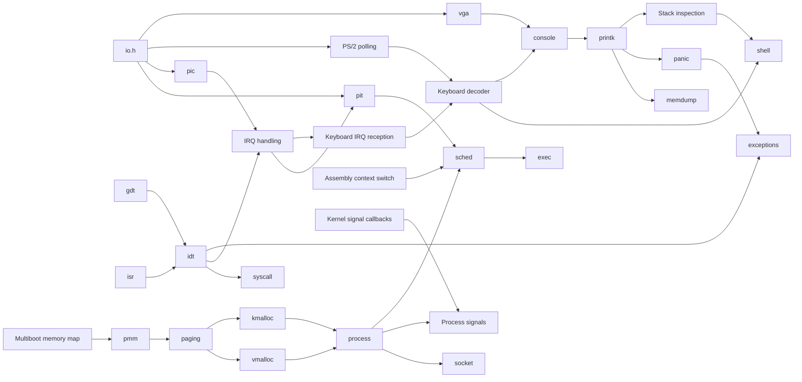

# KFS — Module dependencies

Current implementation and validation: [PROGRESS.md](PROGRESS.md).
Remaining objectives per KFS: [TODO.md](../TODO.md).
This file describes dependencies, not a second task list.

## Current foundation

Boot, port I/O, VGA, console, helpers and printk are implemented.
The PS/2 polling decoder is implemented for ordinary set 1 keys and selected
extended keys; keyboard integration is still being completed.
The later subsystems exist as skeletons in src/ and include/, listed in Makefile.

## Dependencies

An arrow means the target uses or builds on the source. Later-module edges
show the planned design, not implemented behavior.

## Sequence after KFS-1

1. KFS-2: GDT and stack inspection, then the optional shell.
2. KFS-3: preserve Multiboot information, discover physical memory, then paging
   and allocators.
3. KFS-4: IDT, exceptions, PIC/IRQs and timer; reuse the keyboard decoder with
   IRQ reception. Add kernel signals and syscall entry.
4. KFS-5: processes and scheduling on top of memory management, interrupts
   and context switching.

The exact requirements remain those of the original subjects.
