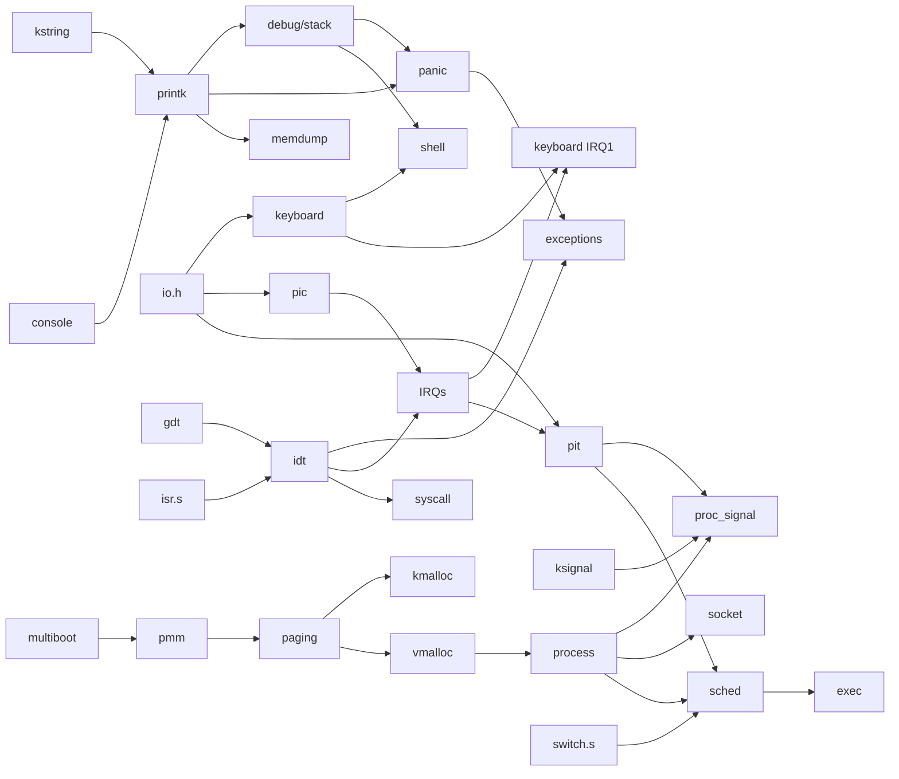

# KFS — Module map and dependencies

Every module below exists as an empty skeleton (`src/...` + `include/...`),
already listed in the Makefile, so the kernel builds at every step. The header
comment of each file states its KFS, role, dependencies and what it unlocks.

## Dependency graph

`A --> B` means "B needs A".

## Can be started now (no missing dependency)

| Module | KFS | Notes |
|---|---|---|
| console fixes | 1 | foundation of all later output |
| `lib/kstring` | 1 | |
| `io.h` | 1/4 | needed by keyboard, pic, pit |
| `drivers/keyboard` (polling) | 1 bonus | decoder reused unchanged by the KFS-4 IRQ handler |
| `cpu/gdt` + `gdt_flush.s` | 2 | |
| `boot/multiboot` | 3 | needs `boot.s` to pass `eax`/`ebx` to the kernel |
| `kfs/signal` (callback registry) | 4 | scheduling part needs pit/idt |
| `drivers/pic` | 4 | writable now, testable only with the IDT |

## Unlocked next

- after `printk`: `debug/stack`, `kfs/panic`, `debug/memdump`
- after `multiboot`: `mm/pmm`, then `mm/paging`, then `kmalloc` / `vmalloc`
- after `gdt`: `cpu/idt` + `isr.s`, then `exceptions`, IRQs, `pit`, `syscall`
- after `keyboard` + `stack`: `shell`
- KFS-5 needs paging (KFS-3) **and** pit/IRQs (KFS-4)
